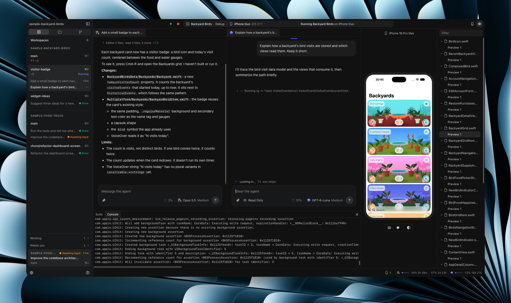

  

<h1 align="center">Chord</h1>

  
  
  

<h2 align="center">Coding agents and the iOS Simulator in one window.</h2>

  Built for iOS developers who ship with coding agents. Every task gets its own git worktree and its own Simulator, so your agents don't step on each other's code or builds. Put pi, Codex or Claude Code on it and watch your app come to life right next to the chat. No more juggling Xcode, Terminal and a git client.

<h3 align="center"><a href="https://github.com/Pistifeju/Chord/releases/latest"><ins>Download Chord</ins></a> &nbsp;·&nbsp; <a href="CONTRIBUTING.md"><ins>Contribute</ins></a></h3>

## Your app, right next to your agents

The Simulator lives inside Chord, beside the agent writing the code. Each worktree gets its own simulator and its own DerivedData, so three tasks can build the same Xcode project at once and nobody's build breaks.

Every `#Preview` in the worktree sits one click away. When an agent changes a SwiftUI file, the preview updates on its own.

## Features

- **Live Simulator.** Your app runs inside Chord, one simulator per worktree.
- **SwiftUI previews.** Every `#Preview` in one list, updated as the agent edits.
- **A worktree per task.** Run tasks in parallel without agents overwriting each other.
- **Status at a glance.** Running, waiting for you, done or failed, for every chat.
- **Split panes.** Several agents, side by side, in one worktree.
- **Changes view.** Review the diff, stage, stash and switch branches.
- **Terminal and editor.** A shell per worktree and an editor for quick fixes.
- **Usage.** See how many tokens every pi, Codex and Claude Code session burned.
- **Any git repo.** Not building for iOS? You still get everything else.

## Supported harnesses

  <a href="https://pi.dev"><kbd> pi</kbd></a> &nbsp;
  <a href="https://github.com/openai/codex"><kbd> Codex</kbd></a> &nbsp;
  <a href="https://docs.anthropic.com/claude/docs/claude-code"><kbd> Claude Code</kbd></a>

## Requirements

- macOS 14 or later
- Xcode
- At least one of [pi](https://github.com/earendil-works/pi), [Codex](https://github.com/openai/codex) or [Claude Code](https://docs.anthropic.com/claude/docs/claude-code)

## License

MIT
